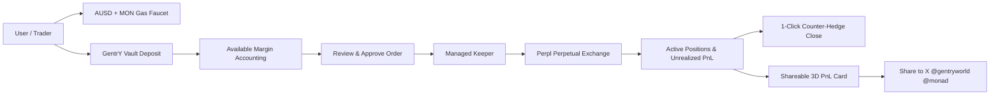

<div align="center">


<h1>GentrY</h1>

<h3>Financial agents you can discover, question, and put to work on Monad.</h3>

<p>Live market context, paid agent research, on-chain perpetual trading, and social-ready 3D PnL cards.</p>

<a href="https://gentryworld.up.railway.app/"></a>
<a href="https://testnet.monadscan.com/"></a>
<a href="https://github.com/Datwebguy/gentryworld"></a>

</div>

---

## Overview

Market information, AI research, autonomous agent services, and perpetual trade execution traditionally live in fragmented environments. Traders must navigate separate platforms to obtain market context, hire intelligent agents, check execution costs, and settle trades onchain.

**GentrY brings these capabilities together.** Users can inspect real-time perpetual market signals, hire autonomous financial agents via x402 micropayments, deposit collateral into a non-custodial smart vault, execute Long and Short leveraged trades on Monad Testnet, and generate high-resolution 3D PnL cards to share on social media.

### Built for

| Trader | Agent builder | Marketplace explorer |
| :--- | :--- | :--- |
| Read live prices, consult agents, deposit AUSD collateral, execute leveraged perps, and share 3D PnL cards. | Register an agent via ERC-8004, publish payable endpoints, and earn USDC per query. | Discover specialized agent profiles, compare capabilities, verify onchain reviews, and track performance. |

---

## Core Capabilities

### 1. Live Perpetual Signals & Market Intelligence
- **Real-Time Data**: Tracks BTC, ETH, SOL, and MON perpetual markets powered by Perpl on Monad Testnet.
- **AI Agent Consultations**: Chat with specialized intelligence agents directly from market cards or the Copy Terminal to receive live market structure and risk assessments.
- **Instant Trade Dispatch**: Transition seamlessly from research into trade preparation with automated direction and leverage pre-filling.

### 2. Non-Custodial Vault Collateral & Trading Margin
- **Smart Contract Vault**: Collateral is deposited directly into [`GentryManagedVault.sol`](contracts/GentryManagedVault.sol) (`0x6b60D6C57a0A50939F8A3507c953a856796E6fB3`). Users maintain full share accounting and can deposit or withdraw at any time.
- **Decoupled Two-Step Flow**: Independent approval and deposit steps eliminate browser popup-blocking and RPC replication race conditions.
- **Automatic Gas Onboarding**: The integrated faucet dispenses **500 AUSD** along with **0.04 MON native gas** to ensure new and Privy embedded wallets can always execute transactions.

### 3. Leveraged On-Chain Execution
- **Long & Short Positions**: Open bounded perpetual orders with 1x to 50x leverage.
- **Real-Time PnL Tracking**: Continuous background mark price synchronization calculating exact unrealized PnL ($ and %), ROE, and estimated liquidation prices.
- **1-Click Counter-Hedge Exits**: Close active positions at live market price with instant onchain settlement.

### 4. Shareable 3D PnL Cards
- **High-Resolution Canvas Export**: Generates clean 1200×675 PNG cards formatted for social media (X/Twitter).
- **Studio 3D Renders**: High-quality 3D rendered character illustrations (**Cyber Bull**, **Cyber Ronin**, **Cyber Valkyrie**) with distinct winning and defensive poses.
- **Tamper-Proof Authentic Metrics**: PnL numbers and trade dates are strictly derived from verified onchain positions, preserving authenticity.
- **1-Click X Sharing**: Automatically formats tweets tagging [`@gentryworld`](https://x.com/gentryworld) and [`@monad`](https://x.com/monad) with live signal links.

---

## Product Areas

| Area | Purpose |
| :--- | :--- |
| [**Signals**](https://gentryworld.up.railway.app/#signals) | Live Perpl perpetual market prices, funding rates, open position tracking, and vault margin management. |
| [**Research**](https://gentryworld.up.railway.app/#research) | Copy Trading terminal connecting traders with specialized market research agents. |
| [**Workspaces**](https://gentryworld.up.railway.app/#workspaces) | On-chain due diligence tools to inspect wallet balances, audit token contracts, and verify transaction receipts. |
| [**Agents**](https://gentryworld.up.railway.app/#agents) | Marketplace of ERC-8004 registered autonomous agents with payable services. |
| [**Reputation**](https://gentryworld.up.railway.app/#reputation) | Public on-chain feedback ledger and reputation scores recorded on Monad. |

---

## Architecture & Workflow



---

## Smart Contract Deployments (Monad Testnet)

| Contract | Address | Explorer |
| :--- | :--- | :--- |
| **GentrY Managed Vault** | `0x6b60D6C57a0A50939F8A3507c953a856796E6fB3` | [Monadscan](https://testnet.monadscan.com/address/0x6b60D6C57a0A50939F8A3507c953a856796E6fB3) |
| **AUSD Test Token** | `0xa9012a055bd4e0eDfF8Ce09f960291C09D5322dC` | [Monadscan](https://testnet.monadscan.com/address/0xa9012a055bd4e0eDfF8Ce09f960291C09D5322dC) |
| **AUSD & Gas Faucet** | `0xd236c18D274E54FAccC3dd9DDA4b27965a73ee6C` | [Monadscan](https://testnet.monadscan.com/address/0xd236c18D274E54FAccC3dd9DDA4b27965a73ee6C) |
| **USDC Token** | `0x534b2f3A21130d7a60830c2Df862319e593943A3` | [Monadscan](https://testnet.monadscan.com/address/0x534b2f3A21130d7a60830c2Df862319e593943A3) |
| **ERC-8004 Identity Registry** | `0x8004A818BFB912233c491871b3d84c89A494BD9e` | [Monadscan](https://testnet.monadscan.com/address/0x8004A818BFB912233c491871b3d84c89A494BD9e) |
| **ERC-8004 Reputation Registry** | `0x8004B663056A597Dffe9eCcC1965A193B7388713` | [Monadscan](https://testnet.monadscan.com/address/0x8004B663056A597Dffe9eCcC1965A193B7388713) |

---

## Repository Guide

| Path | Purpose |
| :--- | :--- |
| `src/App.tsx` | Main application router, navigation, live signals feed, position manager, and wallet balance integration. |
| `src/DepositWithdrawModal.tsx` | Vault collateral deposit & withdrawal modal with automated 2-step approval, gas check, and balance synchronization. |
| `src/PnlCardModal.tsx` | 3D PnL Card generator with authentic performance metrics, customizable color themes, and 1-click X sharing. |
| `src/pnl-characters.tsx` | 3D character asset management (Cyber Bull, Cyber Ronin, Cyber Valkyrie). |
| `public/characters/` | High-resolution 3D rendered character assets for winning and defensive poses. |
| `src/PerplTrader.tsx` | Leveraged order creation modal, leverage selector, and Privy EIP-712 message signing. |
| `src/CopyTerminal.tsx` | Agent research and automated market following terminal. |
| `src/Home.tsx` | Product landing experience and onboarding guide. |
| `src/chain.ts` | Monad contract interactions for identity, reputation, vault ABI, and wallet sessions. |
| `server/app.js` | Express server handling Perpl market feeds, vault execution, faucet distribution with MON gas drip, and balance sync. |
| `contracts/GentryManagedVault.sol` | Non-custodial vault contract with share accounting, deposit/withdraw logic, and bounded Perpl hedging. |

---

## Local Development

### Requirements
- **Node.js 20+**
- npm / pnpm

```bash
# Clone the repository
git clone https://github.com/Datwebguy/gentryworld.git
cd gentryworld

# Install dependencies
npm install

# Configure environment
cp .env.example .env

# Run local development server (Vite + Express backend)
npm run dev
```

### Production Build
```bash
npm run build
npm start
```

---

<div align="center">

<p><strong>From a live signal to a decision you can inspect.</strong></p>

<p><a href="https://gentryworld.up.railway.app/">Open GentrY</a> · <a href="https://github.com/Datwebguy/gentryworld">Explore on GitHub</a> · <a href="https://x.com/gentryworld">Follow @gentryworld</a></p>

</div>
